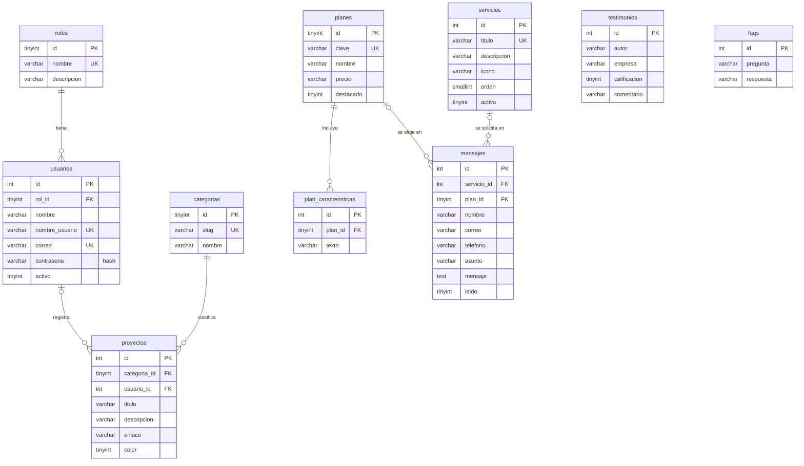

# ValiNix

Sitio web y sistema de información de ValiNix (diseño y desarrollo web), hecho en
PHP sin frameworks con el patrón **MVC (Modelo – Vista – Controlador)** y base de
datos **MySQL**. Tiene dos partes:

- **Sitio público** (visitantes, sin cuenta): cada sección del menú es una página aparte.
- **Panel administrativo** (`/login` → `/admin`): gestión de usuarios, proyectos,
  servicios, testimonios y de los mensajes que llegan por el formulario de contacto.

Sitio publicado: https://valinix.infinityfree.me

| Página               | URL                     | Controlador                 |
|----------------------|-------------------------|-----------------------------|
| Inicio               | `/`                     | `PageController@home`       |
| Nosotros             | `/nosotros`             | `PageController@about`      |
| Servicios            | `/servicios`            | `PageController@services`   |
| Proceso              | `/proceso`              | `PageController@process`    |
| Proyectos            | `/proyectos`            | `PageController@projects`   |
| Precios              | `/precios`              | `PageController@pricing`    |
| Preguntas frecuentes | `/preguntas-frecuentes` | `PageController@faq`        |
| Contacto             | `/contacto`             | `ContactController@show` / `@store` |
| Manual de usuario    | `/manual`               | `PageController@manual` (fuera del menú; enlazado desde Nosotros y el footer) |
| Iniciar sesión       | `/login`                | `AuthController@form` / `@login`, `POST /logout` |
| Panel                | `/admin/...`            | `Controllers/Admin/*` (ver abajo) |

## Tipos de usuario (roles)

| Rol                    | Qué puede hacer |
|------------------------|-----------------|
| **Visitante**          | Navegar el sitio y enviar el formulario de contacto. No necesita cuenta. |
| **Usuario registrado** | Iniciar sesión, consultar proyectos, servicios y testimonios en el panel, y cambiar sus datos y contraseña en *Mi cuenta*. No puede modificar información. |
| **Administrador**      | Todo lo anterior + crear, editar y eliminar proyectos, servicios, testimonios y usuarios (y asignarles el rol), y leer/gestionar los mensajes de contacto. |

Usuario inicial (viene en `database/valinix.sql`): **admin** / **valinix2026**.
El panel muestra un aviso hasta que se cambia esa contraseña en *Mi cuenta*.

## Base de datos

11 tablas (`database/valinix.sql`) con llaves foráneas (más `intentos_login`, que guarda los intentos fallidos de inicio de sesión):



- `database/valinix.sql` — instalación desde cero: crea las tablas (DDL) e inserta los datos iniciales (DML).
- `database/migracion-version-anterior.sql` — convierte la base de la versión anterior a esta estructura sin borrar datos.
- `database/consultas.sql` — consultas de ejemplo: generales, específicas, multitabla
  (`JOIN`, `GROUP BY`, subconsulta), `INSERT`/`UPDATE`/`DELETE` y `ALTER`/`CREATE INDEX`/`VIEW`.
  Al lado de cada una dice en qué método del sistema se usa.

Si la base de datos no está configurada o no responde, el sitio público sigue
funcionando con el contenido de respaldo de `SiteContent`; el panel muestra
"no disponible" y el formulario de contacto avisa "Error al guardar".

### Ya tengo la base de la versión anterior (valinix_db con 8 tablas)

No importes `valinix.sql` (borra las tablas). Usa la migración, que conserva los datos:

1. phpMyAdmin → selecciona `valinix_db` → **Exportar** → Continuar (copia de seguridad).
2. Con `valinix_db` seleccionada → **Importar** → `database/migracion-version-anterior.sql` → Continuar. Una sola vez.
3. Quedan 11 tablas. Los usuarios que ya existían quedan como Administrador y deben
   elegir una contraseña nueva al entrar. La categoría de cada proyecto pasa a la tabla
   `categorias`, el presupuesto de cada mensaje pasa a `plan_id` y el tipo de proyecto queda en el asunto.

La prueba `tests/migracion.sh` (también en GitHub Actions) migra una copia de la base
anterior y revisa que el sitio y el panel funcionen con esos datos.

### Conectar la base de datos en InfinityFree

1. En el panel de InfinityFree: **MySQL Databases** → crea una base (ej. `valinix`).
   Anota el **MySQL Hostname** (ej. `sql123.infinityfree.com`), el **nombre de la base**
   (ej. `if0_12345678_valinix`), el **usuario** (`if0_12345678`) y la **contraseña** de la cuenta.
2. Entra a **phpMyAdmin** de esa base → pestaña **Importar** → elige `database/valinix.sql` → Continuar.
3. En GitHub: *Settings → Secrets and variables → Actions* → crea los secretos
   `DB_HOST`, `DB_NAME`, `DB_USER` y `DB_PASSWORD` con esos datos.
4. Vuelve a ejecutar el workflow (*Actions → Deploy a InfinityFree → Run workflow*).
   El deploy crea `config/database.local.php` con los secretos; ese archivo nunca
   se guarda en el repositorio.

### Conectar en local (XAMPP)

1. Enciende MySQL en XAMPP y en phpMyAdmin crea la base `valinix_db` (utf8mb4_unicode_ci).
2. Importa `database/valinix.sql`.
3. Copia `config/database.example.php` como `config/database.local.php` (ya trae los datos de XAMPP).

## Estructura

```
index.php                  Front controller: toda petición entra por aquí
.htaccess                  Manda las URLs a index.php y bloquea app/, config/ y database/
config/config.php          Datos del sitio (correo, WhatsApp, SEO) y lectura de la conexión
config/database.example.php  Plantilla de la conexión a MySQL
database/                  valinix.sql (tablas y datos) y consultas.sql (ejemplos)

app/
├── bootstrap.php          Autoload de clases, configuración y sesión
├── routes.php             Rutas: URL -> Controlador@método
├── Core/                  "Mini framework"
│   ├── Router.php         Busca la ruta y llama al controlador
│   ├── Controller.php     Base de los controladores (view, redirect, input)
│   ├── View.php           Renderiza vistas dentro del layout
│   ├── Database.php       Conexión PDO a MySQL (consultas preparadas)
│   ├── Model.php          Base de los modelos: run(), all(), one(), value()
│   ├── Auth.php           Inicio/cierre de sesión, roles, bloqueo tras 5 intentos
│   ├── Validator.php      Validación del lado del servidor (obligatorio, longitud, correo, URL, rangos...)
│   ├── Session.php        Sesión, mensajes flash y token CSRF
│   ├── Config.php         Lee config/config.php
│   └── helpers.php        e(), url(), asset(), config(), icon(), csrf_field(), field_error()...
├── Models/                M — una clase por tabla + contenido
│   ├── Usuario.php  Rol.php  Proyecto.php  Categoria.php  Servicio.php
│   ├── Plan.php  Testimonio.php  Faq.php  Mensaje.php
│   ├── Contenido.php      Lo que muestra el sitio público (BD, o respaldo si no hay BD)
│   ├── SiteContent.php    Textos fijos: páginas del menú, misión/visión, home... y el respaldo
│   └── ContactRequest.php Limpia, valida y guarda la solicitud de contacto
├── Controllers/           C — reciben la petición y deciden qué responder
│   ├── PageController.php     Páginas públicas
│   ├── ContactController.php  GET/POST /contacto
│   ├── AuthController.php     /login y /logout
│   ├── ErrorController.php    404 / 405
│   └── Admin/                 Panel (todas heredan de AdminController: exige sesión y CSRF)
│       ├── DashboardController.php   Resumen con totales y gráficos
│       ├── ProyectosController.php   CRUD completo
│       ├── ServiciosController.php   CRUD completo
│       ├── TestimoniosController.php CRUD completo
│       ├── UsuariosController.php    CRUD completo + roles (solo Administrador)
│       ├── MensajesController.php    Consultar, buscar, ver, marcar leído, eliminar
│       └── CuentaController.php      Mi cuenta: datos y contraseña
└── Views/                 V — solo HTML, sin lógica de negocio
    ├── layouts/main.php   Sitio público          layouts/admin.php  Panel
    ├── partials/  pages/  sections/  errors/
    └── admin/             Vistas del panel (una carpeta por módulo: index + form)

css/style.css  css/admin.css  js/script.js  js/admin.js  assets/
tests/smoke.sh             Prueba automática: páginas, formulario, login, permisos y CRUD
```

## Cómo funciona una petición

1. El navegador pide `/servicios` → `.htaccess` la manda a `index.php`.
2. `index.php` carga `app/bootstrap.php` y le pasa la URL al `Router`.
3. El `Router` encuentra la ruta en `app/routes.php` → `PageController@services`.
4. El controlador pide los datos al modelo (`Contenido::services()` → `Servicio::publicos()`
   → `SELECT ... FROM servicios`) y llama a la vista `pages/services`.
5. La vista arma la página dentro de `layouts/main.php` y se envía al navegador.

Ejemplo del CRUD (crear un proyecto): `POST /admin/proyectos/guardar` →
`ProyectosController@guardar` verifica sesión, rol y token CSRF → `Validator` revisa
los campos → `Proyecto::crear()` hace el `INSERT` con una consulta preparada →
redirige a la lista con "Registro guardado correctamente.".

## Cambios comunes

| Quiero cambiar…                         | Dónde                                     |
|-----------------------------------------|-------------------------------------------|
| Proyectos, servicios, testimonios, usuarios | Panel → `/admin`                      |
| Planes y preguntas frecuentes           | Tablas `planes`, `plan_caracteristicas` y `faqs` (phpMyAdmin) |
| Correo, WhatsApp u horario              | `config/config.php`                       |
| Título, descripción o SEO de una página | `SiteContent::pages()`                    |
| Misión, visión y valores                | `SiteContent::about()`                    |
| Diseño/HTML de un bloque                | `app/Views/sections/<bloque>.php`         |
| Reglas de validación                    | `ContactRequest::validate()` y el método `validar()` de cada controlador del panel |
| Manual en PDF                           | reemplaza `assets/docs/manual-usuario-valinix.pdf` |

## Probar en local

Requiere PHP 7.4 o superior con `pdo_mysql` (XAMPP ya lo trae).

```bash
php -S localhost:8000 index.php
```

Abre http://localhost:8000. Para correr las pruebas (con el servidor encendido):

```bash
bash tests/smoke.sh http://localhost:8000 db
```

Usa `nodb` en lugar de `db` para probar el sitio sin base de datos. La prueba `db`
crea y borra registros de prueba: úsala con una base de pruebas, no con la real.

## Despliegue

El workflow `.github/workflows/deploy-infinityfree.yml`:

- En cualquier rama o pull request: revisa la sintaxis, crea las tablas en un MySQL
  de pruebas, ejecuta `consultas.sql` y corre `tests/smoke.sh` con y sin base de datos
  (PHP 7.4 y 8.3).
- En `main`: si las pruebas pasan, crea la conexión con los secretos `DB_*` y sube el
  sitio por FTP a `/htdocs/` de InfinityFree (sin `database/`, `tests/` ni `.github/`).

Secretos del repositorio: `FTP_SERVER`, `FTP_USERNAME`, `FTP_PASSWORD`,
`DB_HOST`, `DB_NAME`, `DB_USER` y `DB_PASSWORD`.
